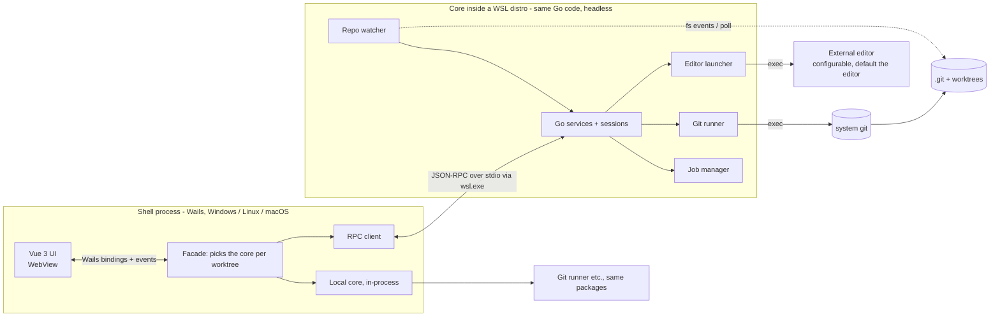

# Architecture — nebegit

This document describes how nebegit is built. What it must do is in `requirements.md`; IDs like `FR-LOG-02` point there.

## Overview

nebegit is a desktop app with a Go backend, a Wails v3 shell and a Vue 3 + TypeScript frontend.

- **Git does the work.** Every git operation runs the system `git` binary. There is no git library and no second engine (ADR-1).
- **Git is the only source of truth.** The app stores no repo data on disk. It caches what it has read in memory and can drop and rebuild that at any time (ADR-4).
- **One backend interface, two placements.** The backend is one Go interface, the *core*. For a repo on the local file system the core runs in-process. For a repo inside a WSL distro the same code runs headless inside that distro, and the shell talks to it over JSON-RPC on stdio (ADR-3).
- **One process, many windows.** Each window shows one selected worktree and can switch to another. Windows showing worktrees of the same repo share that repo's log, caches and locks (ADR-9).
- **The heavy lifting stays in Go.** Go builds the commit log and graph and the UI asks for the rows it is about to show (ADR-5). Writes are serialised by what they lock, so a slow fetch never blocks a commit (ADR-6).

## Documents

- [technical-requirements.md](architecture/technical-requirements.md): TR-01 to TR-37: platforms, tooling, git usage rules, process, UI rules.
- Decisions:
  - [ADR-1: Shell out to git](architecture/adr-1-shell-out-to-git.md)
  - [ADR-2: Wails v3](architecture/adr-2-wails-v3.md)
  - [ADR-3: One core interface; in-process locally, JSON-RPC into WSL](architecture/adr-3-core-placement.md)
  - [ADR-4: Git is the only source of truth](architecture/adr-4-git-is-the-only-source-of-truth.md)
  - [ADR-5: Log and graph are built in Go, the UI renders a window](architecture/adr-5-log-and-graph-in-go.md)
  - [ADR-6: Write queues by what they lock](architecture/adr-6-write-queues-by-what-they-lock.md)
  - [ADR-7: Git computes the diff, CodeMirror 6 merge draws it](architecture/adr-7-diff-ui-with-codemirror-6-merge.md)
  - [ADR-8: Reuse before build](architecture/adr-8-reuse-before-build.md)
  - [ADR-9: One process, one selection per window](architecture/adr-9-one-process-selection-per-window.md)
- [components.md](architecture/components.md): Go packages, frontend structure, main layout, how the parts talk.
- [git-mapping.md](architecture/git-mapping.md): which git commands back which features; background branch update; squash and fixup; log loading; noticing outside changes; jobs; auth; editor launch.
- [errors-security.md](architecture/errors-security.md): the error type and codes; security rules.
- [testing.md](architecture/testing.md): test levels, manual checklist, CI.
- [build-and-layout.md](architecture/build-and-layout.md): packaging, releases, repository layout.
- [risks.md](architecture/risks.md): risks and how each is handled.
- [dependencies.md](architecture/dependencies.md): register of added dependencies (TR-20).
