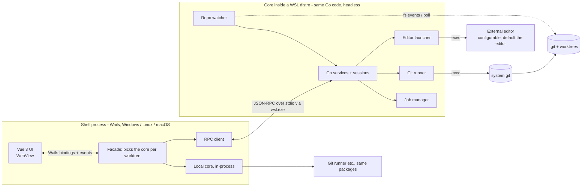

# Architecture — nebegit

Input: `requirements.md`. IDs like `FR-LOG-02` point there. Research notes behind the decisions: plans dir `research/`.

- Desktop app: **Go** backend, **Wails v3** shell, **Vue 3 + TypeScript** frontend.
- All git work runs the system `git` binary. No git library.
- One process; each window shows one selected worktree and can switch via a selector panel (ADR-9).
- No own state about the repo. Git is the source of truth; the app caches in memory only (ADR-4).
- The backend is one Go interface, the **core**. For a Windows or Linux repo it runs in-process, bound to the WebView. For a repo inside WSL the same core runs headless inside the distro and the shell reaches it over JSON-RPC (ADR-3).
- Development is spec-driven, test-driven, and hands-off (TR-29 to TR-32).

---

## Files

- [technical-requirements.md](architecture/technical-requirements.md): TR-01 to TR-33, incl. dev tooling and process.
- Decisions:
  - [ADR-1: Shell out to git](architecture/adr-1-shell-out-to-git.md)
  - [ADR-2: Wails v3](architecture/adr-2-wails-v3.md)
  - [ADR-3: One core interface; in-process locally, JSON-RPC into WSL](architecture/adr-3-core-placement.md)
  - [ADR-4: Git is the only source of truth](architecture/adr-4-git-is-the-only-source-of-truth.md)
  - [ADR-5: Log and graph are built in Go, the UI renders a window](architecture/adr-5-log-and-graph-in-go.md)
  - [ADR-6: Write queues by what they lock](architecture/adr-6-write-queues-by-what-they-lock.md)
  - [ADR-7: Diff UI with CodeMirror 6 merge](architecture/adr-7-diff-ui-with-codemirror-6-merge.md)
  - [ADR-8: Reuse before build](architecture/adr-8-reuse-before-build.md)
  - [ADR-9: One process, one selection per window](architecture/adr-9-one-process-selection-per-window.md)
- [components.md](architecture/components.md): Go packages, services per requirement, frontend stores and layout, events.
- [git-mapping.md](architecture/git-mapping.md): git command per feature; background branch update; log streaming and graph; change detection; jobs; auth; editor launch.
- [errors-security.md](architecture/errors-security.md): error type and codes; security rules.
- [testing.md](architecture/testing.md): test levels, manual checklist, CI.
- [build-and-layout.md](architecture/build-and-layout.md): packaging, releases, repository layout.
- [risks.md](architecture/risks.md)
- [dependencies.md](architecture/dependencies.md): register of added dependencies (TR-20).
