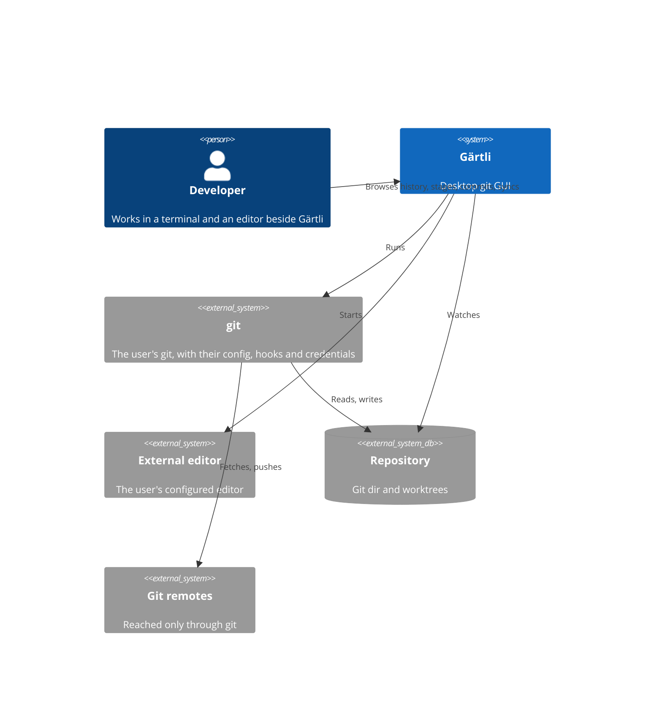
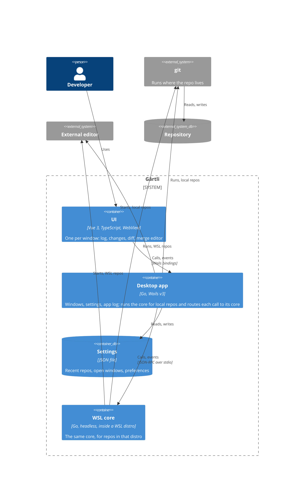
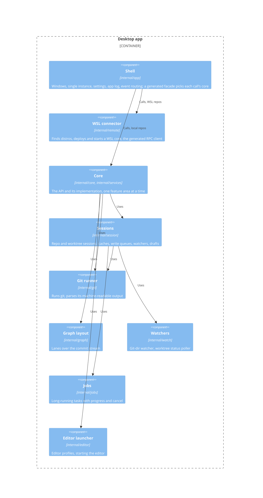

# Architecture — Gärtli

How Gärtli is built. What it does is in `requirements.md`, how its code is written in
`conventions.md`.

## Principles

- **Git does the work.** Every operation runs the user's own git (ADR-1).
- **Git is the only source of truth.** The app keeps no repo data of its own (ADR-4).
- **One core, two placements.** The backend runs in-process for local repos and inside the distro
  for WSL repos, behind one interface (ADR-3).
- **One process, many windows.** Windows on one repo share its log, caches and locks (ADR-8).
- **Heavy lifting in Go.** Go builds the log and graph; the UI fetches only what it shows (ADR-5).

## System context

## Containers

## Components: desktop app

The WSL core is the same core, session, runner and job code behind an RPC dispatcher instead of the
shell.

## Documents

- Decisions:
  - [ADR-1: Shell out to git](architecture/adr-1-shell-out-to-git.md)
  - [ADR-2: Wails v3](architecture/adr-2-wails-v3.md)
  - [ADR-3: One core interface, two placements](architecture/adr-3-core-placement.md)
  - [ADR-4: Git is the only source of truth](architecture/adr-4-git-is-the-only-source-of-truth.md)
  - [ADR-5: Log and graph are built in Go](architecture/adr-5-log-and-graph-in-go.md)
  - [ADR-6: Write queues by what they lock](architecture/adr-6-write-queues-by-what-they-lock.md)
  - [ADR-7: Git computes the diff, CodeMirror draws it](architecture/adr-7-diff-ui-with-codemirror-6-merge.md)
  - [ADR-8: One process, one selection per window](architecture/adr-8-one-process-selection-per-window.md)
- [backend.md](architecture/backend.md): shell and core responsibilities, calls, events, errors.
- [frontend.md](architecture/frontend.md): window state, layout, diff view, merge editor.
- [git-mapping.md](architecture/git-mapping.md): which git commands back which feature.
